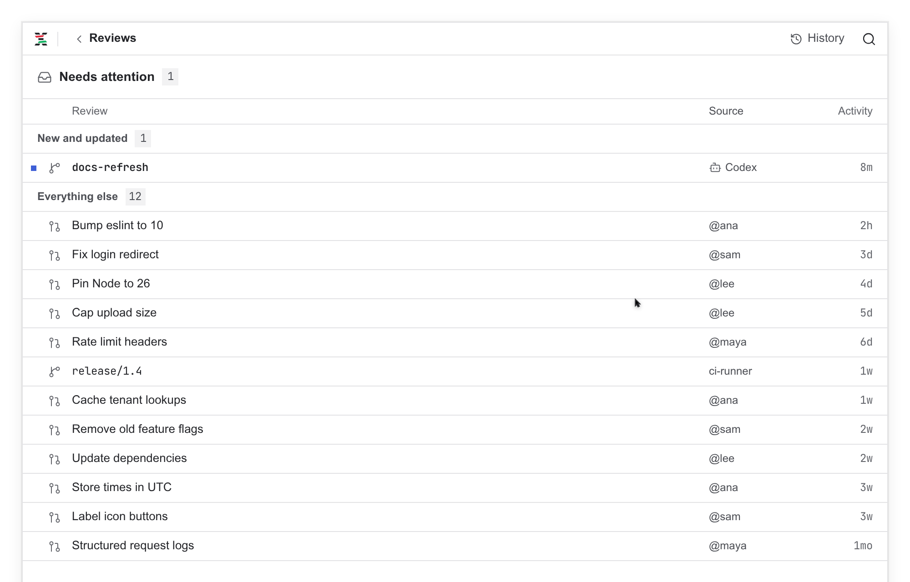

<picture>
  <source media="(prefers-color-scheme: dark)" srcset="docs-website/public/logo-dark.svg">
  
</picture>

### Review the diff. Hand the fixes to your agent.

diffx is a review bench for your changes. It opens pull requests and agent
work as a readable diff, keeps your review comments, and turns them into
instructions a coding agent can act on.

[Open diffx.app](https://diffx.app) · [Docs](https://docs.diffx.app) ·
[Run your own server](https://docs.diffx.app/agent-hooks)

<a href="https://diffx.app">
  <picture>
    <source media="(prefers-color-scheme: dark)" srcset="docs-website/public/readme-cover-dark.webp">
    
  </picture>
</a>

## Why diffx

- **Everything to review, in one place.** Pull requests from every repository
  you follow sit on one bench, newest activity first.
- **Comments that keep up with the code.** Comments and reviewed marks carry
  across new snapshots and re-anchor to code that moved.
- **Agents close the loop.** Over MCP, an agent finds your open threads, fixes
  each concern, replies with what changed and resolves it. You watch every
  reply land.

## Features

**Every review on one bench.** diffx opens on Reviews: each branch and pull
request with changes. Needs attention collects what is new or updated since
you last looked. Move with ↑ and ↓, peek with Space, open with Enter.

**Pull requests arrive on their own.** Connect GitHub and follow repositories.
Their open pull requests, drafts included, appear on the bench and refresh
from GitHub events.

**Comment on the lines that need work.** Comment on any line or file, mark
files reviewed, and copy feedback out as agent-ready XML.

**Let agents address the feedback.** Connect Claude Code, Codex, Cursor or
OpenCode to the server's `/mcp` endpoint. Clients sign in through OAuth; the
browser does not need to stay open while they work.

## Get started

1. **Sign in** at [diffx.app](https://diffx.app), or
   [run your own server](https://docs.diffx.app/agent-hooks).
2. **Follow repositories.** Connect GitHub and
   [follow repositories](https://docs.diffx.app/github-pull-requests); their
   open pull requests appear on the bench.
3. **Connect your agent** to the review it should work on:

   ```sh
   claude mcp add --transport http diffx https://diffx.app/mcp
   ```

   Then ask it to "address the open diffx comments". See
   [MCP](https://docs.diffx.app/mcp) for other clients.

## How it fits together

1. **Pull requests arrive** from the GitHub repositories you follow and
   refresh from GitHub events.
2. **The Reviews bench** shows one row per stream, newest activity first.
   Needs attention shows what changed since you looked.
3. **You read and comment.** Mark files reviewed and comment on lines. Both
   carry across new snapshots.
4. **Agents respond.** Over MCP an agent finds open threads, fixes each
   concern, replies and resolves it.

## Docs

- [User docs](https://docs.diffx.app): getting started, reviewing changes,
  GitHub pull requests, MCP and the API
- [Development](docs/development.md), [architecture](docs/architecture.md),
  [releases](docs/release.md)

## License

[MIT](LICENSE)
